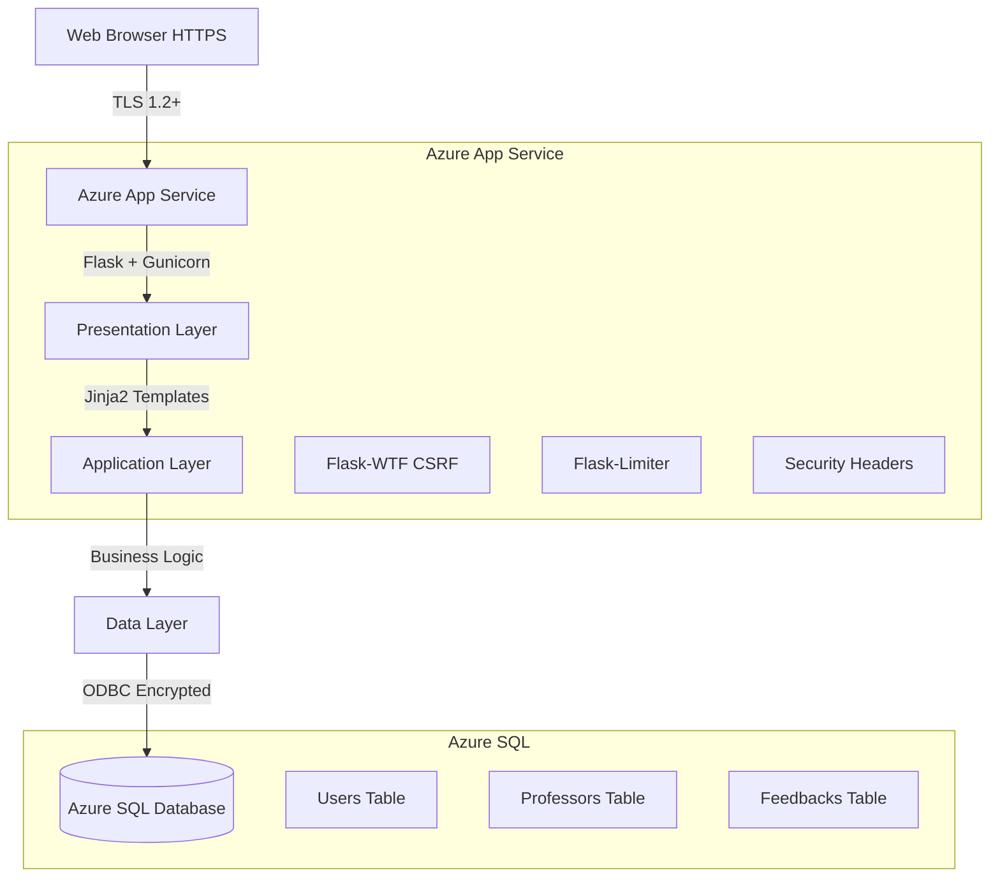
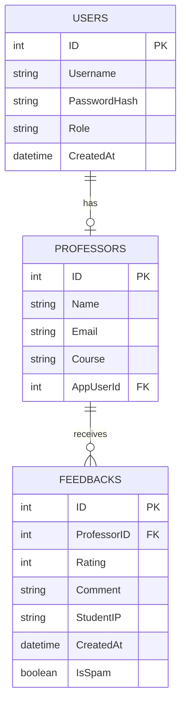

# CampusVoice


<div align="center">


<br><br>

**Secure Anonymous Feedback Platform for Universities**

**Cloud Computing Project — MIATE Master's — FSA Nador**

[Overview](#overview) • [Architecture](#architecture) • [Security](#security) • [Azure Deployment](#azure-deployment) • [Team](#team)

</div>


---

## Table of Contents

- [Overview](#overview)
- [Key Features](#key-features)
- [Architecture](#architecture)
- [Security](#security)
- [Database](#database)
- [User Roles](#user-roles)
- [Installation](#installation)
- [Azure Deployment](#azure-deployment)
- [Project Structure](#project-structure)
- [Tests](#tests)
- [Roadmap](#roadmap)
- [Team](#team)
- [License](#license)

---

## Overview

**CampusVoice** is a secure web platform designed to facilitate **strictly anonymous evaluations** of courses and professors by students. It provides faculty and administrators with a **secure, analytics-driven dashboard** to derive actionable insights.

> **Purpose**: Eliminate response bias and encourage candid feedback by providing a completely anonymous evaluation channel, while ensuring enterprise-grade security, traceability, and scalability via the Microsoft Azure cloud infrastructure.

### Problem Addressed
| Challenge | CampusVoice Solution |
| :--- | :--- |
| **Reluctance to provide candid feedback** | **Strictly anonymous** submission process requiring no user accounts or tracking. |
| **Lack of centralized insights for faculty** | Comprehensive dashboard featuring advanced filtering, statistical analytics, and CSV export capabilities. |
| **Vulnerability to spam and system abuse** | Robust rate limiting and IP-based throttling (1 evaluation per professor/day/IP). |
| **Complex infrastructure management** | Streamlined PaaS deployment utilizing Azure App Service and Azure SQL Database. |

---

## Key Features
| Category | Description |
| :--- | :--- |
| **Strict Anonymity** | Submission without user accounts, tracking mechanisms, or persistent cookies. |
| **RBAC** | Role-Based Access Control (Student / Professor / Administrator). |
| **Real-Time Dashboard** | Dynamic filtering, statistical aggregations, and CSV data export. |
| **Enterprise-Grade Security** | CSRF mitigation, rate limiting, secure HTTP headers, and `HttpOnly` session cookies. |
| **Cloud-Native** | Architected and deployed on Azure App Service + Azure SQL Database. |
| **Data Portability** | Seamless CSV export for external analysis in Excel / Google Sheets. |
| **Spam Mitigation** | Hard limit of 1 feedback submission per professor, per day, per IP address. |

---

## Architecture

### Architecture Diagram



### 3-Tier Architecture
| Layer | Technology | Role |
| :--- | :--- | :--- |
| **Presentation** | Flask + Jinja2 | User interface rendering and HTML/CSS templating. |
| **Application** | Flask + Gunicorn | Business logic execution, authentication, and request throttling. |
| **Data** | Azure SQL Database | Persistent, highly-available storage with encrypted transit. |

----

## Security

### Defense Mechanisms
| Feature | Purpose | Technology |
| :--- | :--- | :--- |
| **CSRF Protection** | Prevent cross-site request forgery | Flask-WTF |
| **Rate Limiting** | Mitigate brute-force and automated spam | Flask-Limiter (5 attempts / 60s) |
| **Spam Mitigation** | Enforce 1 feedback/professor/day/IP limit | Custom application-level logic |
| **Secure Headers** | Defend against XSS, clickjacking, and MIME-sniffing | CSP, HSTS, X-Frame-Options |
| **Session Security** | Prevent session hijacking | `HttpOnly` + `Secure` + `SameSite` cookies |
| **Input Sanitization** | Prevent Cross-Site Scripting (XSS) | `markupsafe.escape()` |

### Azure-Level Security

- **TLS 1.2+** enforced for all data in transit.
- **Azure SQL Firewall** — Rules configured to restrict database access exclusively to the App Service.
- **Secrets Management** — Credentials injected via Environment Variables (zero secrets in source code).
- **Network Isolation** — Private endpoint integration available for production environments.

### Role-Based Authentication
| Role | Authentication | Access Level |
| :--- | :--- | :--- |
| **Student** | None (Anonymous) | Evaluation submission interface only. |
| **Professor** | Username + Password | Dashboard restricted to their specific evaluation data. |
| **Admin** | Username + Password | Unrestricted global access to all institutional data. |

---

## Database

### Relational Schema



---

## User Roles

### Student (Anonymous)

1. Navigates to the public landing page.
2. Reviews and accepts the privacy and anonymity notice.
3. Selects the target professor and course.
4. Submits a quantitative rating (1–5 stars) alongside qualitative comments.
5. Completes submission.
6. **Zero footprint: No account creation, no tracking cookies.**

### Professor (Authenticated)

1. Authenticates via secure credentials.
2. Accesses a personalized dashboard displaying **only their respective evaluations**.
3. Applies filters by date, rating threshold, and specific courses.
4. Exports datasets to CSV for offline review.
5. Reviews aggregated averages and student suggestions.
6. **Strict data isolation: Cannot access peer evaluations.**

### Admin / Coordinator (Authenticated)

1. Authenticates via administrative credentials.
2. Accesses the global institutional dashboard.
3. Utilizes advanced filtering and cross-departmental analytics.
4. Manages faculty profiles (provisioning/deprovisioning).
5. Executes system-wide data exports and compliance reporting.
6. **Full administrative oversight.**

---

## Installation

### Prerequisites

- Python 3.9+
- Azure SQL Database (or local SQL Server instance)
- ODBC Driver 18 for SQL Server
- `pip` (Python package manager)

### Local Installation

**1. Clone the repository**

```bash
git clone https://github.com/boujaadamohammed/campusvoice.git
cd campusvoice
```

**2. Create a virtual environment**

```bash
python -m venv venv
source venv/bin/activate        # Linux/macOS
venv\Scripts\activate           # Windows
```

**3. Install dependencies**

```bash
pip install -r requirements.txt
```

**4. Configure environment variables**

```bash
cp .env.example .env
# Edit .env with your Azure SQL credentials
```

**5. Install the ODBC driver** (if not already present)

```bash
# Ubuntu/Debian:
sudo apt-get install msodbcsql18

# macOS:
brew install msodbcsql18

# Windows: Download via Microsoft Installer
```

**6. Run the application**

```bash
# Development mode
flask run

# Production mode
gunicorn -w 4 -b 0.0.0.0:8000 app:app
```

 Access the interface at: `http://localhost:5000`

### Environment Variables

Create a `.env` file in the root directory:

```bash
# Flask Configuration
FLASK_ENV=production
SECRET_KEY=your-super-secret-key-change-this

# Azure SQL Database
DB_SERVER=your-server.database.windows.net
DB_USER=your-sql-username
DB_PASSWORD=your-sql-password
DB_NAME=campusvoice_db

# Security Settings
SESSION_TIMEOUT=1800           # 30 minutes
MAX_LOGIN_ATTEMPTS=5           # Max login attempts before lockout
RATE_LIMIT_WINDOW=60           # Window in seconds
```

> **SECURITY WARNING: NEVER commit the `.env` file to version control.**

---

## Azure Deployment

### Option 1: Azure CLI (Recommended)

```bash
az login
az group create --name campusvoice-rg --location eastus

az appservice plan create --name campusvoice-plan \
    --resource-group campusvoice-rg --sku B1 --is-linux

az webapp create --resource-group campusvoice-rg \
    --plan campusvoice-plan --name campusvoice-app \
    --runtime "PYTHON|3.11"

az webapp config appsettings set \
    --resource-group campusvoice-rg --name campusvoice-app \
    --settings @settings.json

az webapp up --resource-group campusvoice-rg --name campusvoice-app
```

### Option 2: Azure Portal

1. Provision an **App Service** (Python 3.11 runtime).
2. Provision an **Azure SQL Database**.
3. Deploy the codebase via Git integration or ZIP deploy.
4. Inject environment variables via the Configuration blade.
5. Configure SQL Firewall rules to allow the App Service outbound IP.

### Option 3: GitHub Actions (CI/CD)

Automated deployment pipeline triggered upon repository pushes via `.github/workflows/deploy.yml`.

---

## Project Structure

```text
campusvoice/
│
├── app.py                      # Main Flask application entry point
├── requirements.txt            # Python dependencies manifest
├── .env.example                # Environment variables template
├── .gitignore                  # Git ignore rules
├── Procfile                    # PaaS deployment configuration
│
├── static/                     # Static assets
│   └── style.css               # Global CSS styles
│
├── templates/                  # Jinja2 HTML templates
│   ├── index.html              # Public landing page
│   ├── login.html              # Authentication interface
│   ├── dashboard.html          # Admin/Professor analytics dashboard
│   ├── feedback-form.html      # Anonymous evaluation form
│   └── base.html               # Master layout template
│
├── deployments/                # Cloud configurations
│   ├── azure-deploy.sh         # Bash deployment script
│   └── README_AZURE.md         # Azure-specific documentation
│
└── docs/                       # Technical documentation
    ├── architecture.md         # System architecture overview
    └── security.md             # Security policies and implementation
```

---

## Tests

### Verify Database Connectivity

```bash
# Navigate to: http://localhost:5000/test-db
# Expected output: Connection status and table count verification.
```

### Validate Rate Limiting

```bash
# Execute multiple rapid login attempts. 
# Expected behavior: Access should be temporarily blocked after 5 failed attempts.
```

### Verify CSRF Protection

```bash
# Attempt to submit a form with the CSRF token stripped or manipulated.
# Expected behavior: The server should reject the request with a 400 Bad Request error.
```

---

## Roadmap

### Implemented

- [x] 3-Tier Flask + Azure SQL architecture
- [x] Strict anonymity protocols for student evaluations
- [x] Analytics dashboard with dynamic filtering and CSV export
- [x] CSRF mitigation and application-level rate limiting
- [x] Production deployment on Azure App Service

### In Progress / Upcoming

- [ ] Upgrade password hashing from MD5 to **bcrypt/Argon2**
- [ ] Integrate **Azure Key Vault** for centralized secrets management
- [ ] 🆔 Implement **Microsoft Entra ID** (SSO) integration
- [ ] Enforce **Multi-Factor Authentication** (MFA) for administrative roles
- [ ] Advanced Analytics Dashboard utilizing **Chart.js / D3.js**
- [ ] Cross-platform mobile application via **React Native**
- [ ] Real-time websocket notifications for new feedback
- [ ] Automated institutional reporting via **PDF generation**
- [ ] **Sentiment Analysis** applied to qualitative comments
- [ ] Automated spam detection utilizing **Machine Learning models**

---

## Team

<div align="center">

<table>
<tr>
<td align="center">
<a href="https://github.com/mohammed-boujaada">

<br/>
<sub><b>Mohammed Boujaada</b></sub>
</a>
<br/>
MIATE Master's — FSA Nador
<br/>
<a href="https://github.com/mohammed-boujaada">

</a>
<a href="https://www.linkedin.com/in/mohammed-boujaada-229a3333a/">

</a>
</td>
<td align="center">
<a href="https://github.com/moza369">

<br/>
<sub><b>Mohamed Zahir</b></sub>
</a>
<br/>
MIATE Master's — FSA Nador
<br/>
<a href="https://github.com/moza369">

</a>
</td>
</tr>
</table>

</div>

**Institution**: FSA Nador — Master's in Artificial Intelligence & Emerging Technologies  
**Module**: Cloud Computing  
**Academic Year**: 2025 - 2026

---

## License

This project is provided **as is** strictly for educational and academic purposes.  
Free to use, modify, and distribute within non-commercial, academic contexts.

---

## Acknowledgments

- **Microsoft Azure** — $100 student credit utilized for cloud infrastructure provisioning.
- **Flask** — Lightweight, high-performance Python web framework.
- **FSA Nador** — Academic supervision and foundational project requirements.
- All contributors, peer reviewers, and beta testers.

---

## Citation

```bibtex
@misc{boujaada2026campusvoice,
  author = {Boujaada, Mohammed and Zahir, Mohamed},
  title = {CampusVoice: Anonymous University Feedback Platform on Azure},
  year = {2026},
  publisher = {GitHub},
  journal = {GitHub repository},
  howpublished = {\url{https://github.com/mohammed-boujaada/CampusVoice}}
}
```

---

<div align="center">

### ⭐ If you find this project useful, please consider giving it a star!

**Developed by Mohammed Boujaada & Mohamed Zahir**

**Academic Project — MIATE Master’s — FSA Nador — 2026**

</div>
